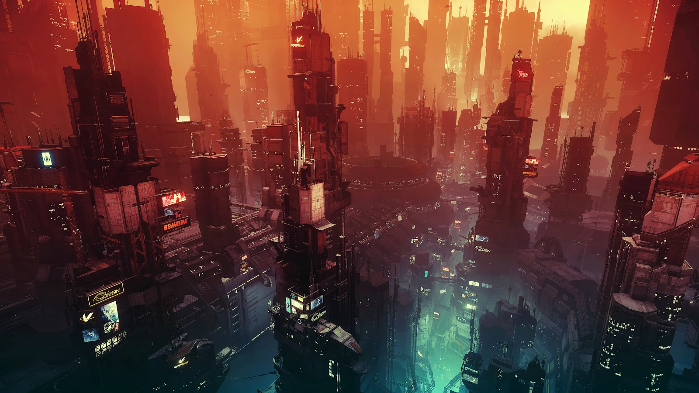

<!-- ░▒▓ CHIGEMEZU-PI // NIGHT CITY NODE ▓▒░ -->

<p align="center">
  
</p>

<p align="center">
  
</p>

<p align="center">
  
  
</p>

```text
 ██████╗██╗  ██╗██╗ ██████╗ ███████╗
██╔════╝██║  ██║██║██╔════╝ ██╔════╝
██║     ███████║██║██║  ███╗█████╗
██║     ██╔══██║██║██║   ██║██╔══╝
╚██████╗██║  ██║██║╚██████╔╝███████╗
 ╚═════╝╚═╝  ╚═╝╚═╝ ╚═════╝ ╚══════╝
   >> MEIZU PRINCE-ISAAC // DUBLIN SECTOR // ONLINE
```

---

### `> whoami`

```yaml
handle:     chige.exe
real_name:  Meizu (Chigemezu) Prince-Isaac
location:   Dublin, IE  // UTC+0
class:      Builder / AI Tinkerer / Founder-in-training
mission:    Build tools that think, then build the company around them.
languages:  [English, Português (learning)]
status:     🟣 jacked in after hours, building in public
```

---

### `> cat /proc/current_status`

| 🛰️ Module | ⚡ Status |
|---|---|
| 🔒 **PROJECT ██████**: `[REDACTED]` | `[■■■■■■□□□□] BUILDING` |
| 🔒 **PROJECT ████**: `[REDACTED]` | `[■■■■□□□□□□] BUILDING` |
| 🔒 **PROJECT ███-███**: `[REDACTED]` | `[■□□□□□□□□□] BOOTING` |
| 🔌 **Make Electronics**: hardware fundamentals | `[■■□□□□□□□□] LEARNING` |
| 🧠 **NeetCode**: daily DSA streak | `[■■■■■■■■■■] DAILY` |

---

### `> ls ./arsenal`

<p>
  
  
  
  
  
  
  
  
  
  
  
</p>

> 🧩 Badges are a self-reported loadout. Delete anything you don't actually use yet, and add things as you learn them.

---

### `> ./featured_projects --clearance=public`

<table>
<tr>
<td width="50%" valign="top">

#### 🔒 PROJECT ██████ // CLASSIFIED
`clearance level: ██████`
```diff
- [DATA EXPUNGED]
- in development. declassified on launch.
```

</td>
<td width="50%" valign="top">

#### 🔒 PROJECT ████ // CLASSIFIED
`clearance level: ██████`
```diff
- [DATA EXPUNGED]
- in development. declassified on launch.
```

</td>
</tr>
<tr>
<td width="50%" valign="top">

#### 🔒 PROJECT ███-███ // CLASSIFIED
`clearance level: ██████`
```diff
- [DATA EXPUNGED]
- in development. declassified on launch.
```

</td>
<td width="50%" valign="top">

#### 📡 INCOMING TRANSMISSION
`more builds loading...`
```diff
+ follow to get pinged when files unlock
```

</td>
</tr>
</table>

> 🕶️ Building in stealth. Public repos drop when they're ready.

---

### `> run diagnostics --stats`

<p align="center">
  
  
</p>

<p align="center">
  
</p>

<p align="center">
  
</p>

---

### `> trace --contributions`

<p align="center">
  <picture>
    <source media="(prefers-color-scheme: dark)" srcset="https://raw.githubusercontent.com/Chigemezu-PI/Chigemezu-PI/output/snake-dark.svg" />
    
  </picture>
</p>

---

### `> open_channel`

<p>
  <a href="https://www.linkedin.com/in/REPLACE_ME"></a>
  <a href="https://www.instagram.com/REPLACE_ME"></a>
  <a href="mailto:REPLACE_ME@example.com"></a>
</p>

```bash
chige@nightcity:~$ echo "Open to collabs on AI, computer vision and startup builds."
Open to collabs on AI, computer vision and startup builds.
chige@nightcity:~$ █
```

<p align="center"><sub>// END OF TRANSMISSION // wake up, chige. we have a city to build. //</sub></p>
